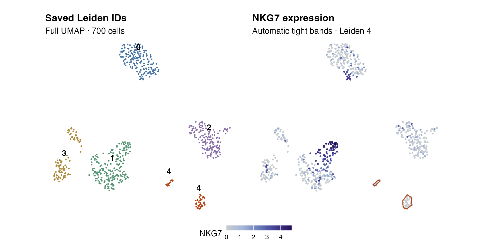

# ggclusteroutline

Draw outlines around labelled groups on a UMAP, PCA or other two-dimensional scatterplot while point colour shows gene expression. The R package takes the existing coordinates and assignments. It computes the outline separately from the point layer.



On this saved PBMC map, Leiden 4 occupies two islands. The tight method shown here produces two convex bands covering the 13 and 35 assigned cells. No other cell centre falls inside. The example table and its provenance ship with the package.

## Install

To install the local v0.1.1 candidate from its checkout, run:

```r
install.packages("pak")  # once
pak::local_install(".")
```

With dependencies installed, use the checked v0.1.1 source archive from the directory containing it:

```sh
R CMD INSTALL ggclusteroutline_0.1.1.tar.gz
```

The previously published source archive is available from the [v0.1.0 release](https://github.com/nbatada/ggclusteroutline/releases/tag/v0.1.0).

## Choose what the outline should show

The one-line default draws the regions where each label locally dominates. With no tuning it drew 22 of 23 Yost groups and 13 of 18 NSCLC groups. A dispersed group may have no territory. Use `tight` for an all-member band when every member can be assigned to one supported island. It drew two bands for PBMC cluster 4 and abstained on both full atlases. Use `islands` when every member needs a glyph or enclosure. Its tile width can split a compact cloud into many pieces (21 paths for the audited 400-point Gaussian at defaults).

```r
library(ggplot2)
library(ggclusteroutline)

cells <- read.csv(system.file("extdata", "pbmc700.csv", package = "ggclusteroutline"))
p <- ggplot(cells, aes(x, y)) +
  geom_point(aes(colour = NKG7), size = 0.7) +
  coord_equal()

p + geom_cluster_outline(aes(group = leiden))
p + geom_cluster_outline(aes(group = leiden), clusters = 4, method = "tight")
```

Always supply the full map. The `clusters` argument selects which outlines to display after all eligible labels have competed. Each ordinary ggplot facet uses its own panel data. Separate outline tables must carry the facet variables for each panel unless you set `replicate = TRUE` to repeat those data across the missing facets. Set outline styling outside `aes()`, for example `colour = "black"`. If the point layer overrides the global coordinates, pass its coordinates explicitly to the outline, for example `aes(x = UMAP_1, y = UMAP_2, group = leiden)`. Use `coord_cartesian()` to zoom while keeping the full geometry input.

| Method | What the line means | What to look for |
|---|---|---|
| `"tight"` | Convex envelope around the observed cell centres assigned to each supported island. Territory contours provide candidate islands. | A returned group covers its members. Ambiguous or unsupported assignments can leave the group without an outline. Other labels may lie inside a hull. |
| `"islands"` | Enclose each connected set of occupied tiles within the original label. All member centres contribute, including isolated points. | Adjacent tiles connect along edges or corners. Tile width controls separation. Distinct labels can have overlapping hulls. |
| `"territory"` (default) | Inset contour of the region where this label has the largest smoothed cell count and meets its own density threshold. | Useful for overlapping populations. A rare or intermixed label may have no band. The contour can omit members and include other labels. |

The tight and territory modes use the existing CellStyle territory algorithm as their reference. For a full-member outline even when territory support is incomplete, use `method = "islands"`. This uses 8-neighbour tile connectivity within each supplied label (DBSCAN on occupied tile centres, minimum one tile). It preserves the existing biological assignments. `bandwidth` sets a smoothing length in embedding units, `mass` controls support before competition, and `grid_size` sets grid resolution. Check the result on the full labelled embedding. For known components, `compute_cluster_outlines(..., component = "island_id")` directly encloses each supplied component.

## On a Seurat DimPlot

```r
# 'leiden' must be a metadata column containing the assignments to outline.
dimplot <- Seurat::DimPlot(object, reduction = "umap", group.by = "leiden",
                          combine = FALSE)[[1]]
dimplot + geom_cluster_outline(aes(group = leiden), clusters = "4")
```

Using an individual ggplot makes the target panel explicit when Seurat returns multiple plots. The example uses the existing UMAP and cluster assignments.

## Freeze geometry across expression plots

```r
bands <- compute_cluster_outlines(cells, "x", "y", "leiden", clusters = 4)
attr(bands, "diagnostics")
saveRDS(bands, "leiden-4.rds")
p + geom_cluster_outline(data = readRDS("leiden-4.rds"), colour = "black")
```

The saved `vertex` numbers preserve path order after sorting or joining rows. Use frozen paths only for their originating embedding, membership and facet definition. New objects store geometry input column names, an order-sensitive input fingerprint, coordinate space and software versions in `attr(bands, "provenance")`. Compare fingerprints to check source identity when reusing saved results. For example, pass `facets = "sample"` when precomputing geometry for independent sample panels. The automatic in-session cache hashes coordinates, labels, selection, mode and geometry parameters. A new marker colour reuses geometry. Changing a competitor or coordinate invalidates that panel. Row reordering can miss the cache. The cache holds at most 16 results and 16 MiB of estimated geometry, with least-recently-used eviction. Use `cache = FALSE` for cold measurements or `clear_outline_cache()` to release its entries.

## Evidence and limitations

Cell-centre containment on existing CellStyle benchmark inputs, using the 256-node grid, 1.2%-of-span bandwidth and 97% mass profile:

| Full embedding | Cells / labels | Inside own territory | Inside own ggforce hull |
|---|---:|---:|---:|
| Yost BCC T cells | 33,106 / 23 | 22,515 (68.0%) | 33,106 (100%) |
| NSCLC T/NK cells | 622,791 / 18 | 395,316 (63.5%) | 622,791 (100%) |

To inspect territory coverage, compute the regions and read the member and other-label counts for each cluster:

```r
regions <- compute_cluster_outlines(cells, "x", "y", "leiden", method = "territory")
attr(regions, "diagnostics")[c("cluster", "input_points", "assigned_points", "other_points")]
```

The ggforce counts use polygons extracted from actual ggforce renders. Broad hulls can include many cells assigned to other labels. The package's territory classifications differed from CellStyle Python for one Yost cell-by-label decision and zero NSCLC decisions. These comparisons concern visualization on a fixed partition. Linear Cartesian axes are the supported coordinate space. For variable-density embeddings, inspect component count, overlap and omissions before reusing paths.

[Benchmark methods, timings and memory](https://github.com/nbatada/ggclusteroutline/blob/v0.1.0/benchmarks/rc/README.md) · [Full PBMC comparison PDF](https://github.com/nbatada/ggclusteroutline/blob/v0.1.0/benchmarks/rc/pbmc700.pdf) · [Research audit](https://github.com/nbatada/ggclusteroutline/blob/v0.1.0/AUDIT.md) · [MIT license](https://github.com/nbatada/ggclusteroutline/blob/v0.1.0/LICENSE.md)
