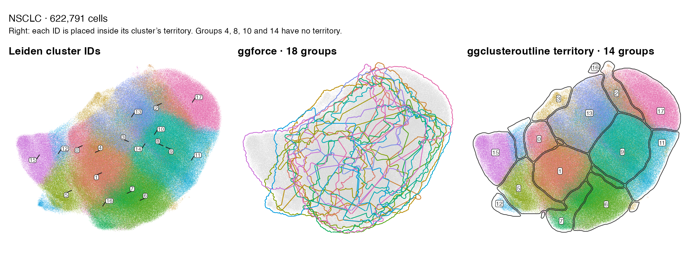
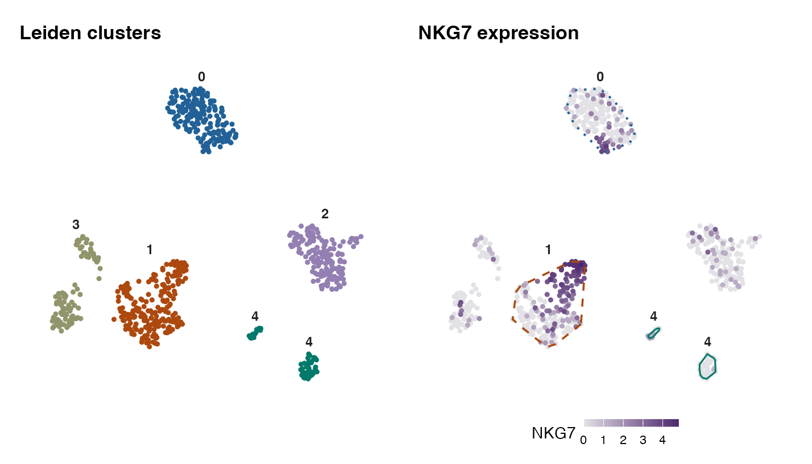
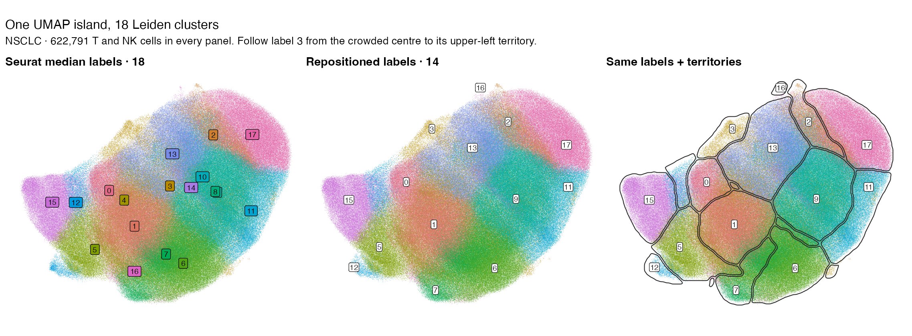
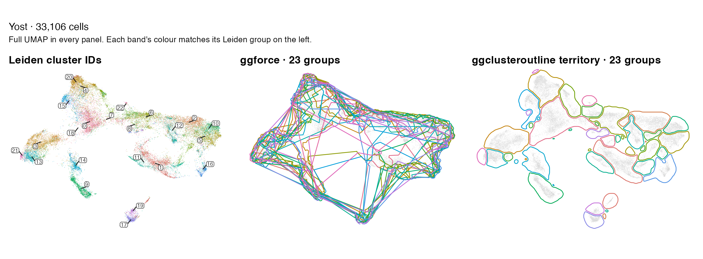
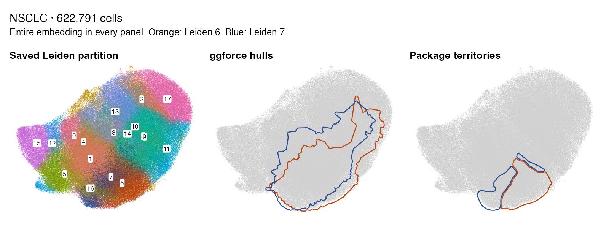
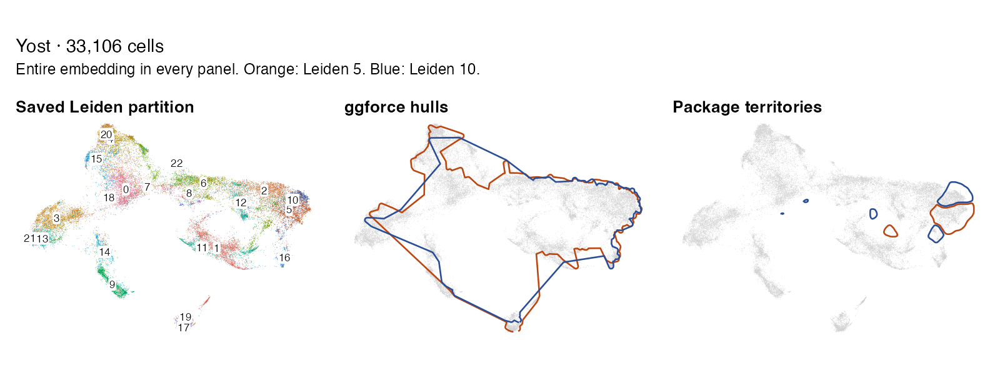

# ggclusteroutline

**Install and load the R package `ggclusteroutline`.** Its ggplot2 layer is `geom_cluster_outline()`. The fully qualified call is `ggclusteroutline::geom_cluster_outline()`.

**One UMAP island can contain many clusters.** When several labels overlap in one cloud, a cluster ID at its median can be hard to match to the cells. ggclusteroutline places each supported ID inside a region where that cluster is locally most abundant. Show the labels alone or add boundaries, and keep point colour available for gene expression.



In this lung cancer dataset, several Leiden clusters share one large UMAP island. A few distant members can pull a hull across much of the map. The territory outlines on the right show where each group concentrates. Four of the 18 groups have no territory at the settings shown.

## Install v0.2.0

```r
install.packages("remotes")  # once
remotes::install_github("nbatada/ggclusteroutline@v0.2.0", upgrade = "never")
packageVersion("ggclusteroutline")  # 0.2.0
```

[Download the tested R source archive and checksum](https://github.com/nbatada/ggclusteroutline/releases/tag/v0.2.0).

## Try it on your own Seurat FeaturePlot

Start with a Seurat object named `object` that already has a UMAP, cluster identities and a gene in its active assay. Set the gene and cluster ID for your data. `FeaturePlot()` carries the active identities in its plot data as `ident`; if you keep your desired assignments in a metadata column, set `Idents(object) <- "leiden"` (or `"seurat_clusters"`) first.

```r
library(Seurat)
library(ggplot2)
library(ggclusteroutline)

gene <- "NKG7"                           # a feature in your active assay
levels(Idents(object))                   # available cluster IDs
cluster_id <- "4"                        # choose one of those IDs

p <- FeaturePlot(object, features = gene, reduction = "umap",
                 combine = FALSE)[[1]] +
  scale_x_continuous() + scale_y_continuous()  # allow outlines beyond the outermost cells

# One cluster: keep all cells visible, including the neighboring clusters.
p + geom_cluster_outline(aes(group = ident), clusters = cluster_id,
                         colour = "black", linewidth = 0.6)

# All clusters with a supported territory: omit the clusters argument.
p + geom_cluster_outline(aes(group = ident), colour = "black", linewidth = 0.6)
```

Pass `clusters = c("0", "4")` to highlight several groups. Select groups in the outline layer so it can compare their local densities against the full map. A dispersed cluster can legitimately have no territory.



The example above uses different line styles and the optional `tight` method to show the two islands of PBMC cluster 4.

**Automatic territory labels.** Add `label = TRUE` to print one ID per supported cluster on the FeaturePlot.
Each label sits on a member cell inside its territory, including when the
territory spans several islands. You can also save these positions for reuse.

```r
p + geom_cluster_outline(aes(group = ident), colour = "black", label = TRUE)
```

### Reposition cluster IDs without drawing outlines

For a Seurat UMAP that normally uses `DimPlot(..., label = TRUE)`, build it
with `label = FALSE` and let ggclusteroutline draw the IDs once:

```r
p <- Seurat::DimPlot(object, reduction = "umap", group.by = "leiden",
                     label = FALSE, combine = FALSE)[[1]]
p + geom_cluster_outline(aes(group = leiden), label = "only")
```

Use your cluster metadata column in both places. This option uses
the same label positions as `label = TRUE`. Each ID sits on an observed member
cell inside the computed territory. A cluster without an interior member in a
supported territory stays unlabelled. The cell assignments and colours are preserved.



**Follow cluster 3.** Seurat places its median label near several other IDs in the centre. The middle panel moves it onto a cluster-3 cell in the upper-left part of the island. The right panel shows the territory that determined that position. All panels show the same 622,791 cells and all 18 assignments. At the NSCLC benchmark settings, 14 clusters have territories. Groups 4, 8, 10 and 14 remain visible as points and receive no territory label.

## Save UMAP outlines and label positions once

Use `label = TRUE` when **computing** the territories to save their label positions too. Here `object` is your Seurat object and `leiden` is its cluster metadata column. Match cell IDs when combining the embedding and metadata.

```r
xy <- SeuratObject::Embeddings(object, reduction = "umap")[, 1:2, drop = FALSE]
cells <- data.frame(x = xy[, 1], y = xy[, 2],
                    leiden = object[[]][rownames(xy), "leiden"])
territories <- compute_cluster_outlines(cells, "x", "y", "leiden", label = TRUE)
saveRDS(territories, "umap-territories.rds")
```

In a later R session, load `ggclusteroutline` and read the file. On a plot of the same UMAP, choose what to display. All three calls read saved coordinates directly.

```r
territories <- readRDS("umap-territories.rds")
p <- Seurat::DimPlot(object, reduction = "umap", group.by = "leiden",
                     label = FALSE, combine = FALSE)[[1]]

p + geom_cluster_outline(territories, colour = "black")               # outlines
p + geom_cluster_outline(territories, label = "only")                 # labels
p + geom_cluster_outline(territories, label = TRUE, colour = "black") # both
```

You can keep the same object in `object@misc[["ggclusteroutline"]]` when saving your Seurat object. Reuse it when changing the gene or palette. Recompute after changing cells, assignments, UMAP coordinates, facets or geometry settings. Files saved without label positions still draw their original outlines.

## How does it compare with ggforce?

The panels use identical coordinates and assignments within each study. The middle panel draws a ggforce concave hull for each Leiden group. The right panel draws its locally dominant territory. Look for outlines that cross a neighboring group's cells.



| Reading the examples | Members among cells inside the ggforce hull | Members among cells inside the territory | Cluster members retained by the territory |
|---|---:|---:|---:|
| NSCLC T/NK · cluster 6 | 23.6% | **66.9%** | 72.1% |
| Yost BCC T cells · cluster 5 | 7.9% | **67.6%** | 51.8% |

Both hulls enclosed every member of the selected group. The territory sacrifices coverage to show the local concentration. A cell outside its group's outline keeps its original assignment. These full-map comparisons use a 256-node grid per axis, bandwidth of 1.2% of the longer map span and 97% density mass; the quick start uses the package defaults. [NSCLC selected groups](man/figures/nsclc-selected.png) · [Yost selected groups](man/figures/yost-selected.png).

### Two clusters in the same island

**NSCLC.** Follow groups 6 (orange) and 7 (blue) near the bottom of the main island. The ggforce hulls overlap across much of the map. The territory for group 6 encloses 42,229 of its 58,560 members and 20,900 cells from other groups. Its ggforce hull encloses all 58,560 members and 189,534 other cells. [Liu et al., GSE243013](https://www.ncbi.nlm.nih.gov/geo/query/acc.cgi?acc=GSE243013)



**Yost basal cell carcinoma.** Follow group 10 (blue) on the authors’ T-cell UMAP. Its territory has five rings enclosing 939 of 1,505 members and 474 other cells. Its ggforce hull spans most of the map, enclosing all 1,505 members and 22,528 other cells. Both studies use benchmark-derived Leiden IDs. [Yost et al., GSE123813](https://www.ncbi.nlm.nih.gov/geo/query/acc.cgi?acc=GSE123813)



## Choose what the outline should show

The one-line default draws the regions where each label locally dominates. With no tuning it drew 22 of 23 Yost groups and 13 of 18 NSCLC groups. A dispersed group may have no territory. Use `tight` for an all-member band when every member can be assigned to one supported island. It drew two bands for PBMC cluster 4 and abstained on both full atlases. Use `islands` when every member needs a glyph or enclosure. Its tile width can split a compact cloud into many pieces (21 paths for the audited 400-point Gaussian at defaults).

```r
library(ggplot2)
library(ggclusteroutline)

cells <- read.csv(system.file("extdata", "pbmc700.csv", package = "ggclusteroutline"))
p <- ggplot(cells, aes(x, y)) +
  geom_point(aes(colour = NKG7), size = 0.7) +
  coord_equal()

p + geom_cluster_outline(aes(group = leiden))
p + geom_cluster_outline(aes(group = leiden), clusters = 4, method = "tight")
```

Always supply the full map. The `clusters` argument selects which outlines to display after all eligible labels have competed. Each ordinary ggplot facet uses its own panel data. Separate outline tables must carry the facet variables for each panel unless you set `replicate = TRUE` to repeat those data across the missing facets. Set outline styling outside `aes()`, for example `colour = "black"`. If the point layer overrides the global coordinates, pass its coordinates explicitly to the outline, for example `aes(x = UMAP_1, y = UMAP_2, group = leiden)`. Use `coord_cartesian()` to zoom while keeping the full geometry input.

| Method | What the line means | What to look for |
|---|---|---|
| `"tight"` | Convex envelope around the observed cell centres assigned to each supported island. Territory contours provide candidate islands. | A returned group covers its members. Ambiguous or unsupported assignments can leave the group without an outline. Other labels may lie inside a hull. |
| `"islands"` | Enclose each connected set of occupied tiles within the original label. All member centres contribute, including isolated points. | Adjacent tiles connect along edges or corners. Tile width controls separation. Distinct labels can have overlapping hulls. |
| `"territory"` (default) | Inset contour of the region where this label has the largest smoothed cell count and meets its own density threshold. | Useful for overlapping populations. A rare or intermixed label may have no band. The contour can omit members and include other labels. |

The tight and territory modes use the existing CellStyle territory algorithm as their reference. For a full-member outline even when territory support is incomplete, use `method = "islands"`. This uses 8-neighbour tile connectivity within each supplied label (DBSCAN on occupied tile centres, minimum one tile). It preserves the existing biological assignments. `bandwidth` sets a smoothing length in embedding units, `mass` controls support before competition, and `grid_size` sets grid resolution. Check the result on the full labelled embedding. For known components, `compute_cluster_outlines(..., component = "island_id")` directly encloses each supplied component.

## On a Seurat DimPlot

```r
# 'leiden' must be a metadata column containing the assignments to outline.
dimplot <- Seurat::DimPlot(object, reduction = "umap", group.by = "leiden",
                          combine = FALSE)[[1]]
dimplot + geom_cluster_outline(aes(group = leiden), clusters = "4")
```

Using an individual ggplot makes the target panel explicit when Seurat returns multiple plots. The example uses the existing UMAP and cluster assignments.

If an outline crosses a cluster label, start with the unlabelled `dimplot` above and add boxed labels last so they cover the line where they overlap.

```r
outlined <- dimplot + geom_cluster_outline(aes(group = leiden), clusters = "4")
Seurat::LabelClusters(outlined, id = "leiden", box = TRUE)
```

## Evidence and limitations

Cell-centre containment on existing CellStyle benchmark inputs, using the 256-node grid, 1.2%-of-span bandwidth and 97% mass profile:

| Full embedding | Cells / labels | Inside own territory | Inside own ggforce hull |
|---|---:|---:|---:|
| Yost BCC T cells | 33,106 / 23 | 22,515 (68.0%) | 33,106 (100%) |
| NSCLC T/NK cells | 622,791 / 18 | 395,316 (63.5%) | 622,791 (100%) |

To inspect territory coverage, compute the regions and read the member and other-label counts for each cluster:

```r
regions <- compute_cluster_outlines(cells, "x", "y", "leiden", method = "territory")
attr(regions, "diagnostics")[c("cluster", "input_points", "assigned_points", "other_points")]
```

The ggforce counts use polygons extracted from actual ggforce renders. Broad hulls can include many cells assigned to other labels. The package's territory classifications differed from CellStyle Python for one Yost cell-by-label decision and zero NSCLC decisions. These comparisons concern visualization on a fixed partition. Linear Cartesian axes are the supported coordinate space. For variable-density embeddings, inspect component count, overlap and omissions before reusing paths.
